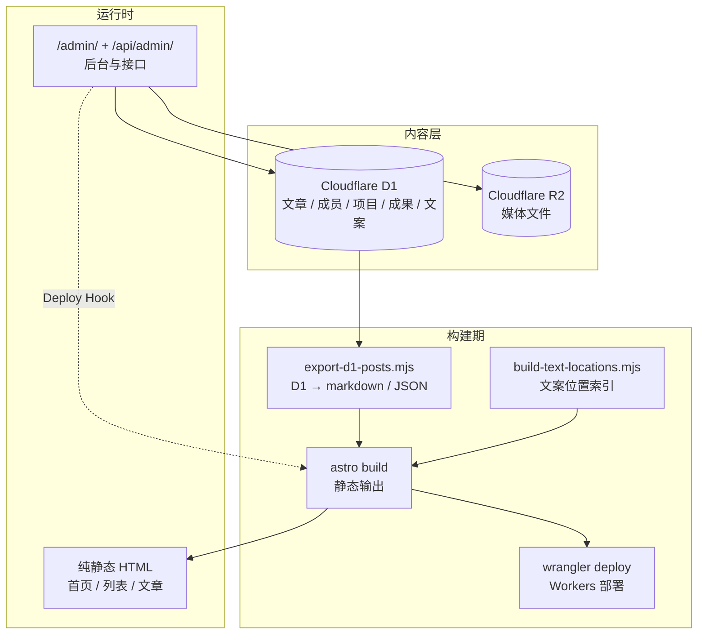

<a id="readme-top"></a>

# OurTeam

[![Astro 7][astro-shield]][astro-url]
[![Cloudflare Workers][cf-shield]][cf-url]
[![TypeScript 6][ts-shield]][ts-url]
[![Tailwind CSS 4][tw-shield]][tw-url]
[![pnpm][pnpm-shield]][pnpm-url]

> 课题组官方网站 —— Astro 7 静态站 + Cloudflare Workers，内容存在 D1 里，构建时导出成静态页面。
> 线上运行的是纯静态 HTML；D1 只服务后台与构建流程，R2 存放媒体文件。

**仓库**：[ikaraseay/MeoOurTeam][repo-url] · **模板**：复制 `config.env.example` 即可改造成任意课题组站点

<details>
<summary><strong>目录</strong></summary>

<ol>
  <li><a href="#about">项目简介</a></li>
  <li><a href="#features">核心特性</a></li>
  <li><a href="#built-with">技术栈</a></li>
  <li><a href="#architecture">系统架构</a></li>
  <li><a href="#getting-started">快速开始</a>
    <ul>
      <li><a href="#prerequisites">前置条件</a></li>
      <li><a href="#installation">本地安装</a></li>
      <li><a href="#commands">常用命令</a></li>
    </ul>
  </li>
  <li><a href="#deployment">生产部署</a></li>
  <li><a href="#configuration">配置说明</a></li>
  <li><a href="#structure">目录结构</a></li>
  <li><a href="#content-system">内容系统</a></li>
  <li><a href="#admin">后台与发布</a></li>
  <li><a href="#seo">SEO 与体验</a></li>
  <li><a href="#faq">常见问题</a></li>
  <li><a href="#roadmap">路线图</a></li>
  <li><a href="#contributing">贡献指南</a></li>
  <li><a href="#acknowledgments">致谢</a></li>
</ol>

</details>

<p align="right">(<a href="#readme-top">返回顶部</a>)</p>

---

<a id="about"></a>

## 项目简介

OurTeam 是一个课题组 / 实验室官网模板，采用「静态生成 + 运行时 Worker」的混合架构：

- **前台纯静态**：页面在构建期渲染完成，运行时**不查 D1** —— D1 只服务后台与构建流程；
- **内容即数据**：后台写 D1，构建期导出 markdown、站点内容与文案覆盖，再生成静态 HTML；
- **单管理员后台**：`/admin/` —— 文章、成员、研究方向、项目、成果、新闻、素材库、文案、品牌图标、发布中心；
- **文案可定位**：默认文案在仓库里，线上覆盖存 D1；后台可预览、审计，并按页面位置反查文案 key；
- **发布可回滚**：发布中心记录版本，通过 Cloudflare Deploy Hook 触发构建，失败可回到上一版；
- **模板化配置**：仓库里的 `wrangler.jsonc` 与 `astro.config.mjs` 只放占位符，真值在 `config.env`，构建前自动填回。

<p align="right">(<a href="#readme-top">返回顶部</a>)</p>

<a id="features"></a>

## 核心特性

### 内容管理

- **D1 驱动**：文章、成员、研究方向、项目、成果、新闻、文案、媒体元数据都存在 Cloudflare D1；
- **构建期导出**：`pnpm build` 自动从 D1 拉取内容，生成 markdown 与运行时 JSON；
- **发布 ≠ 上线**：后台只改数据库，站点要等下一次构建才更新；
- **素材库**：图片等二进制进 R2，元数据进 D1，后台支持上传、预览与删除；
- **文案覆盖**：默认文案在 `frontend/lib/text-defaults.json`，D1 覆盖值在构建时注入 `__PUBLISHED_TEXT__`；
- **文案审计**：每次修改记录操作人、旧值、新值；后台还能按页面位置定位文案 key；
- **发布中心**：记录构建版本与状态，支持激活历史版本和回滚到上一版。

### 用户体验

- **深色模式**：跟随系统偏好，首屏前同步判定，不闪；
- **响应式布局**：首页、成员、研究方向、项目、成果、新闻、联系页统一栅格；
- **博客系统**：列表、详情、标签页、分页、站内搜索；
- **纯静态搜索**：搜索索引在构建期生成，浏览器端匹配标题、摘要与标签；
- **RSS / Sitemap / Robots**：订阅、站点地图与爬虫规则全部构建期输出；
- **安全响应头**：`nosniff`、`SAMEORIGIN`、Referrer-Policy 与 Permissions-Policy。

### 技术特性

- **Astro 7**：静态优先，只在后台与 API 路由启用 SSR；
- **三层目录**：`frontend/` 站点、`backend/` 后台逻辑、`cloudflare/` 部署配置；
- **Tailwind CSS 4**：原子类 + CSS token，品牌色由 `--brand-blue` 派生；
- **TypeScript 6**：`astro check` 全量类型检查，CI 中强制执行；
- **配置与密钥分离**：`config.env`、`cloudflare/.dev.vars`、`data/` 全部不入库；
- **提交前扫描**：`.githooks/pre-commit` 拦截疑似口令、密钥与账号 ID；
- **GitHub Actions**：安装 → 生成 Worker 类型 → 类型检查 → 构建。

<p align="right">(<a href="#readme-top">返回顶部</a>)</p>

<a id="built-with"></a>

## 技术栈

| 层 | 技术 |
|---|---|
| 框架 | Astro 7 · 静态输出 + `@astrojs/cloudflare` 适配器 |
| 运行时 | Cloudflare Workers · 静态资源与接口一次部署，同域无跨域 |
| 数据库 | Cloudflare D1（SQLite）· 内容、文案、媒体元数据、发布记录 |
| 对象存储 | Cloudflare R2 · 媒体文件二进制 |
| 样式 | Tailwind CSS 4 + CSS token · 深色模式跟随系统 |
| 内容 | Astro Content Collections · Markdown |
| 包管理 | pnpm 12 · Node 钉在 `.node-version` |
| 类型检查 | TypeScript 6 + `astro check` |
| 部署 | Wrangler · 直接上传或 Cloudflare Workers Builds |

<p align="right">(<a href="#readme-top">返回顶部</a>)</p>

<a id="architecture"></a>

## 系统架构



**数据流**：后台改 D1 → 构建期导出 markdown / 站点数据 / 文案覆盖 → Astro 静态输出 → 部署到 Workers → 运行时前台不碰数据库。

<p align="right">(<a href="#readme-top">返回顶部</a>)</p>

---

<a id="getting-started"></a>

## 快速开始

<a id="prerequisites"></a>

### 前置条件

| 项 | 要求 |
|---|---|
| Node.js | ≥ 26.13（`.node-version` 写的 26.13.0） |
| pnpm | 12+（`package.json` 的 `packageManager` 钉版本） |
| Cloudflare 账号 | D1 / R2 / Workers |
| Cloudflare 凭据 | `config.env` 里的 `CLOUDFLARE_API_TOKEN`（或 `bash scripts/ops.sh login`） |

<a id="installation"></a>

### 本地安装

```bash
git clone https://github.com/ikaraseay/MeoOurTeam.git
cd MeoOurTeam

pnpm install
cp config.env.example config.env    # 填站点地址 / 库 id / 桶名 / 凭据
bash scripts/ops.sh doctor          # 体检
pnpm types                          # 生成 Worker 类型（worker-configuration.d.ts）
pnpm dev                            # 开发服务器
```

`config.env` 是**唯一**需要填真实环境值的地方（不入库）。仓库里的 `cloudflare/wrangler.jsonc` 与 `astro.config.mjs` 放的是占位符，构建前由 `scripts/apply-config.mjs` 把真值填回去。

本地开发如果没有真实 D1，可以先跑 `bash scripts/ops.sh init-db` 初始化远程库，或直接用种子数据：

```bash
bash scripts/ops.sh seed            # 生成并导入种子数据
pnpm sync                           # 从 D1 拉最新内容到本地
```

<a id="commands"></a>

### 常用命令

```bash
pnpm dev              # 开发服务器
pnpm build            # 构建（先跑导出）
pnpm preview          # 预览构建产物
pnpm types            # 生成 Worker 类型声明
pnpm check            # 类型检查（astro check）
pnpm sync             # 从 D1 拉最新内容到本地
pnpm clean            # 清理本地内容副本
pnpm hooks:install    # 启用 .githooks/pre-commit
pnpm deploy           # 部署到 Cloudflare Workers
node scripts/hash-password.mjs 'your-password'   # 生成后台口令哈希
```

运维脚本：

| 命令 | 作用 |
|---|---|
| `bash scripts/ops.sh doctor` | 体检：工具链 / 依赖 / 配置 / Cloudflare 登录 |
| `bash scripts/ops.sh login` | 交互式登录 Cloudflare（已配置 Token 时不需要） |
| `bash scripts/ops.sh init-db` | 创建 D1 并执行全部迁移 |
| `bash scripts/ops.sh secrets` | 同步后台口令与会话密钥到 Worker |
| `bash scripts/ops.sh env` | 写本地开发凭据到 `cloudflare/.dev.vars` |
| `bash scripts/ops.sh deploy` | 构建并部署 |
| `bash scripts/ops.sh seed [--local]` | 生成并导入种子数据 |
| `bash scripts/ops.sh export-data [--local]` | 导出 D1 数据为 JSON |
| `bash scripts/ops.sh import-data <file> [--local]` | 从 JSON 导入 D1 |
| `bash scripts/ops.sh generate-seed` | 生成种子 JSON 文件 |

<p align="right">(<a href="#readme-top">返回顶部</a>)</p>

<a id="deployment"></a>

## 生产部署

### 1. Cloudflare 资源准备

```bash
# 创建 D1 数据库
pnpm wrangler d1 create ourteam-content
# 返回的 database_id 填进 config.env 的 D1_DATABASE_ID

# 创建 R2 存储桶
pnpm wrangler r2 bucket create ourteam-media
# 桶名填进 config.env 的 R2_BUCKET_NAME
```

### 2. 初始化数据库

```bash
bash scripts/ops.sh init-db
```

脚本会创建 D1（若尚不存在）并依次执行 `backend/db/migrations/` 下的迁移。

### 3. 配置后台凭据

```bash
# 生成口令哈希
node scripts/hash-password.mjs 'your-password'

# 同步到 Worker secret
bash scripts/ops.sh secrets
```

也可以手动上传：

```bash
pnpm wrangler secret put ADMIN_PASSWORD_HASH --config cloudflare/wrangler.jsonc
pnpm wrangler secret put SESSION_SECRET --config cloudflare/wrangler.jsonc
```

### 4. 构建与部署

```bash
bash scripts/ops.sh deploy
```

等价于 `pnpm build` + `wrangler deploy --config dist/server/wrangler.json`。

### 5. 域名

在 `config.env` 里把 `SITE_URL` 改成正式域名，再在 Cloudflare Dashboard 的 Worker 设置里绑定自定义域名。

### 6. 后台触发构建

后台「发布中心 → 立即构建」通过 Cloudflare Deploy Hook 触发构建。整个项目只使用**一个账户级 Token**（`CLOUDFLARE_API_TOKEN`），用于部署、D1、R2 和 secret 同步，**不需要用户级 Token**。

> Workers Builds API 只接受用户级 Token，账户级 Token 调用会返回 `Authentication error`。因此构建配置在 Dashboard 做一次性设置，日常触发走无需认证的 Deploy Hook。

#### 一次性配置

1. **连接仓库**：Worker → Settings → Builds → Connect GitHub，选择 `ikaraseay/MeoOurTeam`。
2. **构建命令**：
   - Build command：`pnpm build`
   - Deploy command：`pnpm exec wrangler deploy --config dist/server/wrangler.json`
3. **构建环境变量**（Builds → Variables and Secrets）：

| 变量 | 值 |
|---|---|
| `SITE_URL`、`WORKER_NAME`、`D1_DATABASE_NAME`、`D1_DATABASE_ID`、`R2_BUCKET_NAME`、`CLOUDFLARE_ACCOUNT_ID` | 与 `config.env` 相同 |
| `D1_REMOTE_TOKEN`（secret） | 同一个账户级 Token |

4. **创建 Deploy Hook**：同一页面创建后复制 URL，填入 `config.env`：

```bash
DEPLOY_HOOK_URL="https://api.cloudflare.com/client/v4/workers/builds/deploy_hooks/<uuid>"
```

5. **写入 Worker 并测试**：

```bash
bash scripts/ops.sh secrets          # 同步 DEPLOY_HOOK_URL 等 secret
curl -X POST "$DEPLOY_HOOK_URL"      # 可选：手动触发一次构建
```

之后后台「立即构建」直接调用 Hook。Hook URL 本身就是密钥，调用端无需认证；构建时使用的 Build Token 由 Cloudflare 面板自动管理。

> Builds API 无法用账户级 Token 创建或修改构建配置与 Hook，必须先在 Dashboard 完成上述一次性步骤。Cloudflare 文档说明账户级 Token 的 Builds API 支持仍在开发中。

#### Token 权限（账户级，一个 Token 完成部署与数据操作）

同一份 `CLOUDFLARE_API_TOKEN` 用于 `deploy`、`secrets`、D1 数据操作，以及作为构建环境的 `D1_REMOTE_TOKEN`：

| 范围 | 权限 | 级别 | 用途 |
|---|---|---|---|
| Account | Workers Scripts（Workers 脚本） | Edit | 部署、写入 Worker secret |
| Account | D1 | Read | 构建期 `wrangler d1 execute --remote` 导出内容 |
| Account | Workers R2 Storage（Workers R2 存储） | Edit | 创建 R2 桶、管理媒体文件 |
| Account | Account Settings（帐户设置） | Read | 读取账号信息，固定 `CLOUDFLARE_ACCOUNT_ID` 时可不加 |

需要 `init-db`、`seed`、`import-data` 时，把 **D1** 提升为 **Edit**。

可选：

| 范围 | 权限 | 级别 | 用途 |
|---|---|---|---|
| Zone（站点所在区） | Workers Routes（Workers 路由） | Edit | 仅当由 wrangler 管理自定义域名路由时需要 |

不需要任何 **User** 权限。也不要依赖 **Workers CI** 权限——Builds API 对账户级 Token 一律拒绝。Token 创建位置是 **Manage Account → Account API Tokens**，Account Resources 选择站点所在账号。

脚本用 `/accounts/{account_id}/tokens/verify` 校验账户级 Token，`bash scripts/ops.sh doctor` 应显示「Token 有效」。

没有配置 Hook 时，后台会提示「直接上传部署」，用 `bash scripts/ops.sh deploy` 发布即可。

<p align="right">(<a href="#readme-top">返回顶部</a>)</p>

<a id="configuration"></a>

## 配置说明

| 文件 | 作用 | 入库 |
|---|---|---|
| `config.env` | 环境值唯一事实源（站点地址 / 库 id / 桶名 / 凭据） | 否 |
| `config.env.example` | 环境值模板 | 是 |
| `cloudflare/wrangler.jsonc` | Worker 绑定声明（占位符，构建前填充） | 是 |
| `astro.config.mjs` | Astro 配置（站点地址占位符，构建前填充） | 是 |
| `cloudflare/.dev.vars` | 本地 secret（由 `ops.sh env` 生成） | 否 |
| `frontend/lib/text-defaults.json` | 界面文案默认值 | 是 |
| `data/runtime/` | 构建期从 D1 导出的运行时数据 | 否 |
| `data/content/blog/` | 构建期从 D1 导出的文章 | 否 |
| `worker-configuration.d.ts` | `pnpm types` 生成的 Worker 类型 | 否 |

**仓库是模板**：`cloudflare/wrangler.jsonc` 与 `astro.config.mjs` 里是占位符（库 id / 桶名 / 域名），真值在 `config.env`（不入库），构建前由 `scripts/apply-config.mjs` 填回去。

`config.env` 主要变量：

| 变量 | 说明 |
|---|---|
| `SITE_URL` | 站点地址，如 `https://example.com` |
| `WORKER_NAME` | Cloudflare Worker 名称 |
| `D1_DATABASE_NAME` | D1 数据库名称 |
| `D1_DATABASE_ID` | D1 数据库 ID |
| `R2_BUCKET_NAME` | R2 存储桶名称 |
| `CLOUDFLARE_ACCOUNT_ID` | Cloudflare 账号 ID |
| `CLOUDFLARE_API_TOKEN` | 唯一的账户级 Token：部署 / D1 / R2 / secrets 共用 |
| `DEPLOY_HOOK_URL` | Deploy Hook，在 Dashboard 一次性创建后填入 |
| `ADMIN_PASSWORD_HASH` | 后台口令 SHA-256 |
| `SESSION_SECRET` | 会话签名密钥（`openssl rand -hex 32`） |

<p align="right">(<a href="#readme-top">返回顶部</a>)</p>

<a id="structure"></a>

## 目录结构

```text
MeoOurTeam/
├── config.env.example              # 环境值模板（真值在 config.env，不入库）
├── astro.config.mjs                # Astro 配置
├── frontend/                       # 站点本体（Astro 的 srcDir）
│   ├── pages/                      # 路由（页面、后台、API、RSS、Sitemap）
│   ├── components/                 # 组件（Hero / Members / Research / BlogSearch …）
│   ├── layouts/                    # 布局（Layout / AdminLayout）
│   ├── styles/                     # Tailwind 入口 + 主题 token
│   ├── lib/                        # 站点配置、文案、SEO、数据查询
│   └── content/blog/               # 手写 / 种子文章
├── backend/                        # 后台逻辑
│   ├── lib/admin/                  # 会话 / 口令 / 数据库 / 站点内容 / 文案
│   ├── middleware.ts               # 鉴权（拦 /admin/* 与 /api/admin/*）
│   ├── db/migrations/              # D1 表结构
│   └── scripts/                    # 构建期导出（D1 → markdown / JSON）
├── cloudflare/                     # 部署层
│   ├── wrangler.jsonc              # Worker 绑定声明（占位符）
│   └── public/                     # 静态资源 + _headers / _redirects
├── data/                           # 构建期导出的运行时数据（不入库）
├── scripts/                        # 运维脚本、配置填充、口令哈希
├── docs/                           # 数据管理说明
└── .github/workflows/ci.yml        # GitHub Actions
```

<p align="right">(<a href="#readme-top">返回顶部</a>)</p>

<a id="content-system"></a>

## 内容系统

D1 是唯一真身，仓库里不保存线上内容：

| 东西 | 存在哪 | 怎么进站 |
|---|---|---|
| 文章 | D1 `documents` | 构建期导出 `data/content/blog/<slug>.md` → Astro Content Collection |
| 成员 | D1 `members` | 构建期写入 `data/runtime/site-content.json` |
| 研究方向 | D1 `research_directions` | 同上 |
| 项目 | D1 `projects` | 同上 |
| 成果 | D1 `outcomes` | 同上 |
| 新闻 | D1 `news` | 同上 |
| 界面文案 | D1 `text_resources` | 构建期写入 `data/runtime/published-text.json`，注入 `__PUBLISHED_TEXT__` |
| 媒体 | R2 + D1 `media` | 后台上传，元数据存 D1 |
| 发布记录 | D1 `releases` / `current_release` | 发布中心写入，支持回滚 |

**发布 ≠ 上线**：后台改的是 D1，站点是构建期产物，得等下一次构建才更新。构建流程：

```text
pnpm build
  ├─ scripts/apply-config.mjs          # config.env → wrangler.jsonc / astro.config.mjs
  ├─ backend/scripts/export-d1-posts.mjs   # D1 → markdown / JSON / 文案覆盖
  ├─ scripts/build-text-locations.mjs  # 文案 key → 页面位置索引
  └─ astro build                       # 静态输出
```

<p align="right">(<a href="#readme-top">返回顶部</a>)</p>

<a id="admin"></a>

## 后台与发布

访问 `/admin/login` 登录，单管理员模式：

- **文章管理**：草稿 / 发布、分类、标签、发布日期；
- **素材库**：上传图片到 R2，查看元数据、复制路径、删除；
- **文案管理**：默认文案与 D1 覆盖合并展示，支持预览、按页面定位、修改审计；
- **站点资料**：团队成员、研究方向、项目、成果、新闻；
- **品牌图标**：favicon / 社交分享图等站点身份资源；
- **发布中心**：记录构建版本、状态与时间，支持激活历史版本和回滚。

### 安全设计

- 后台口令只存 SHA-256 哈希（Worker secret `ADMIN_PASSWORD_HASH`）；
- 会话使用 HMAC-SHA256 签名，Cookie 为 `HttpOnly; Secure; SameSite=Strict`，有效期 7 天；
- 同一 IP 10 分钟内最多 5 次登录失败；
- `/admin/*` 与 `/api/admin/*` 由 `backend/middleware.ts` 统一鉴权；
- API 请求体与上传大小都有上限；
- `config.env`、`.dev.vars`、`data/`、生成类型均不入库，pre-commit hook 再扫一遍敏感信息。

<p align="right">(<a href="#readme-top">返回顶部</a>)</p>

<a id="seo"></a>

## SEO 与体验

- **Canonical / OG / Twitter Card**：由 `Layout.astro` 按页面生成；
- **JSON-LD**：组织信息结构化数据；
- **RSS**：`/rss.xml`；
- **Sitemap**：`/sitemap.xml`；
- **Robots**：`/robots.txt`；
- **深色模式**：首屏前同步判定，避免闪烁；
- **站内搜索**：`/blog/search-index.json` + 浏览器端匹配；
- **标签与分页**：`/blog/tag/<tag>/`、`/blog/page/<n>/`；
- **响应式**：移动端导航与单列布局；
- **安全响应头**：见 `cloudflare/public/_headers`。

<p align="right">(<a href="#readme-top">返回顶部</a>)</p>

---

<a id="faq"></a>

## 常见问题

| 现象 | 排查方向 |
|---|---|
| `astro check` 报找不到 `cloudflare:workers` | 先跑 `pnpm types` 生成 `worker-configuration.d.ts` |
| `astro check` 报缺少 `@astrojs/check` 或 `@emnapi/runtime` 崩溃 | 重新 `pnpm install`；仓库已用 override 把 `@emnapi/runtime` 钉在兼容版本 |
| 构建后文章 / 成员为空 | `config.env` 没填好，或 `CLOUDFLARE_API_TOKEN` 无权读取 D1；先跑 `bash scripts/ops.sh doctor` |
| 后台保存后前台没变化 | 站点是构建期产物，需要重新构建（发布中心或 `bash scripts/ops.sh deploy`） |
| 后台「立即构建」返回 501 | 没有配置 `DEPLOY_HOOK_URL`：在 Dashboard 创建 Hook，填入 `config.env` 后执行 `bash scripts/ops.sh secrets` |
| Builds API 返回 `Authentication error` | 账户级 Token 不能调用 Builds API，构建配置需在 Dashboard 一次性完成 |
| 构建失败或内容为空 | 检查 Builds 环境变量，尤其是 `D1_REMOTE_TOKEN` 是否已配置为 secret |
| 登录一直失败 | `ADMIN_PASSWORD_HASH` 与输入口令不一致，用 `node scripts/hash-password.mjs` 重新生成 |
| 本地后台看不到线上内容 | 先 `pnpm sync`，确认 `config.env` 与 wrangler 登录态正常 |
| CI 在安装阶段失败 | 确认 pnpm 12 与 `pnpm-lock.yaml` 一致，不要手工改锁文件 |
| 提交被 pre-commit 拦住 | 检查是否误加了 `config.env`、`.dev.vars` 或真实账号 ID |
| 新环境没有 Worker 类型 | `pnpm types`，该文件由 wrangler 生成且不入库 |

<p align="right">(<a href="#readme-top">返回顶部</a>)</p>

---

<a id="roadmap"></a>

## 路线图

- [x] Astro 7 + Cloudflare Workers 混合架构
- [x] D1 驱动的内容系统
- [x] 单管理员后台（文章 / 成员 / 项目 / 成果 / 新闻 / 素材）
- [x] 文案覆盖、页面定位与修改审计
- [x] 发布中心与版本回滚
- [x] 博客标签、分页与站内搜索
- [x] RSS / Sitemap / Robots / JSON-LD
- [x] GitHub Actions 类型检查与构建
- [ ] 演示站点与示例数据
- [ ] 多语言站点
- [ ] 访问统计与评论（按需）

欢迎通过 [Issues][issues-url] 提出建议或报告问题。

<p align="right">(<a href="#readme-top">返回顶部</a>)</p>

<a id="contributing"></a>

## 贡献指南

1. Fork 本仓库，创建特性分支：`git checkout -b feature/your-feature`
2. 提交前跑通本地校验：`pnpm types`、`pnpm check`、`pnpm build`
3. 提交变更：`git commit -m "feat: ..."` 并发起 Pull Request

**请勿提交任何真实凭据**：`config.env`、`cloudflare/.dev.vars`、`data/`、`worker-configuration.d.ts` 均已忽略。

首次克隆后建议执行 `pnpm hooks:install`，启用提交前的敏感信息扫描。

<p align="right">(<a href="#readme-top">返回顶部</a>)</p>

<a id="acknowledgments"></a>

## 致谢

- [Astro](https://astro.build/) · [@astrojs/cloudflare](https://www.npmjs.com/package/@astrojs/cloudflare)
- [Cloudflare Workers](https://developers.cloudflare.com/workers/) · D1 · R2 · Workers Builds
- [Tailwind CSS](https://tailwindcss.com/) · [@tailwindcss/typography](https://github.com/tailwindlabs/tailwindcss-typography)
- [Shiki](https://shiki.style/) · 代码高亮
- [Shields.io](https://shields.io) · [Best-README-Template](https://github.com/othneildrew/Best-README-Template)

<p align="right">(<a href="#readme-top">返回顶部</a>)</p>

<!-- MARKDOWN LINKS -->
[astro-shield]: https://img.shields.io/badge/Astro-7-FF5D01?logo=astro&logoColor=white
[astro-url]: https://astro.build/
[cf-shield]: https://img.shields.io/badge/Cloudflare-Workers-F38020?logo=cloudflare&logoColor=white
[cf-url]: https://developers.cloudflare.com/workers/
[ts-shield]: https://img.shields.io/badge/TypeScript-6-3178C6?logo=typescript&logoColor=white
[ts-url]: https://www.typescriptlang.org/
[tw-shield]: https://img.shields.io/badge/Tailwind_CSS-4-06B6D4?logo=tailwindcss&logoColor=white
[tw-url]: https://tailwindcss.com/
[pnpm-shield]: https://img.shields.io/badge/pnpm-12-F69220?logo=pnpm&logoColor=white
[pnpm-url]: https://pnpm.io/
[repo-url]: https://github.com/ikaraseay/MeoOurTeam
[issues-url]: https://github.com/ikaraseay/MeoOurTeam/issues
